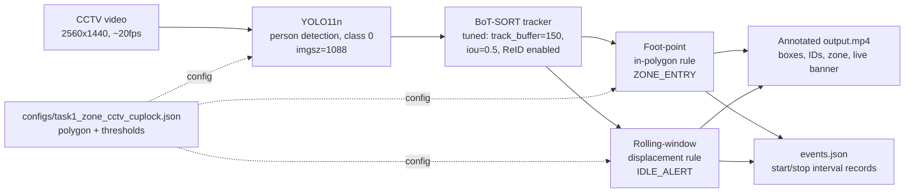
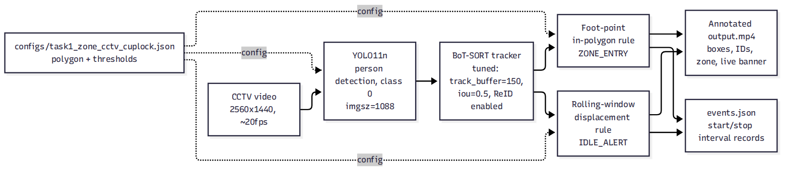
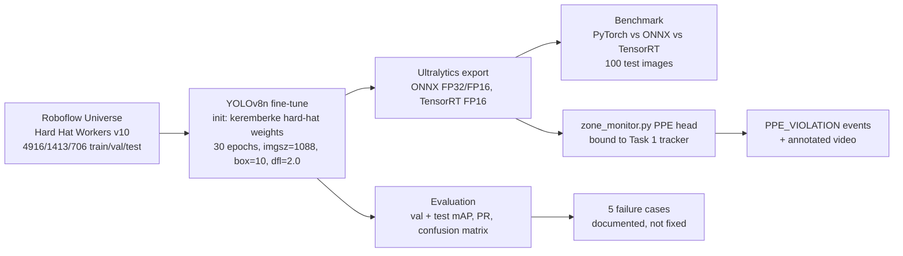
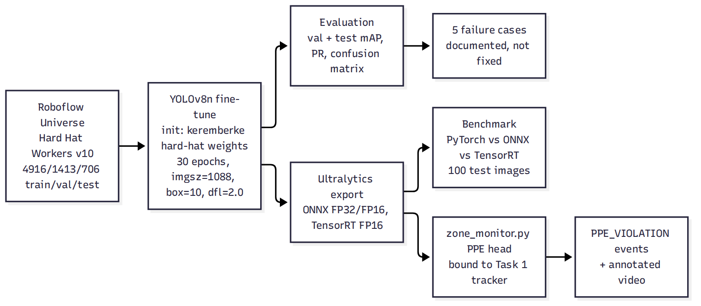
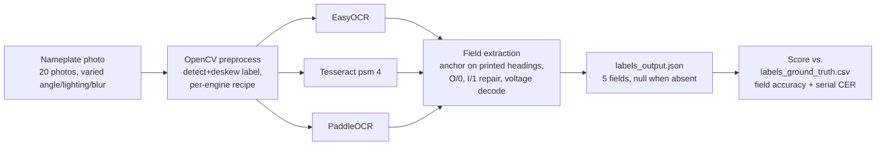
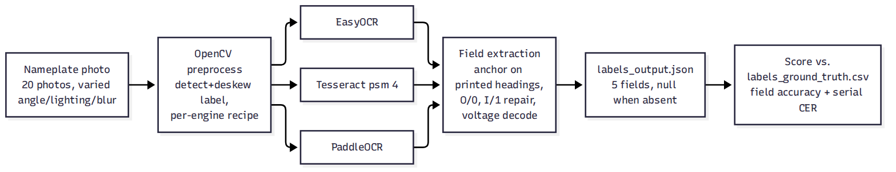
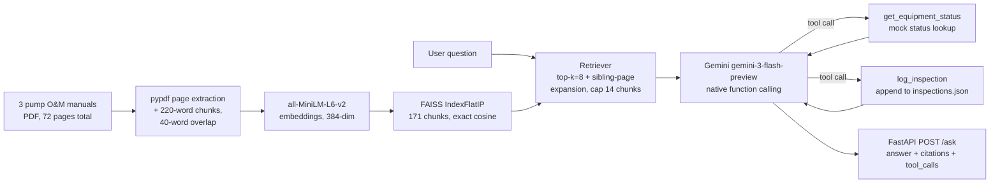
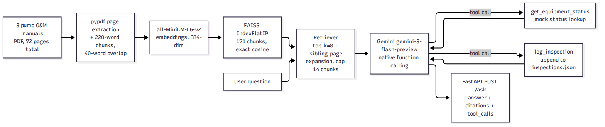

# System Design

Architecture, design choices, limitations, and deployment plan for each task.
Written against the finished build for Tasks 1, 3 and 4. Task 2's section is
a placeholder pending the final model export (ONNX/TensorRT) — updated once
that lands.

---

## Task 1 — Object Detection and Zone Monitoring

### Architecture

### Design choices and why

| Choice | Value | Why |
|---|---|---|
| Detector | YOLO11n, person class only | Pretrained, fast, sufficient for a single-class person detector at this scale |
| Detection resolution | imgsz=1088 (native 2560x1440) | Default 640 dropped confidence to 0.15 during partial occlusion near machinery; 1088 raised the floor to 0.53 — measured, not assumed |
| NMS IoU | 0.5 (down from Ultralytics default 0.7) | 0.7 let duplicate overlapping boxes survive on the same person (measured IoU 0.64-0.68 between phantom pairs); 0.5 killed them, dropped unique track count 7→5 with no loss of real tracks |
| Tracker | BoT-SORT, tuned (`botsort_tuned.yaml`) | Config-driven per spec requirement #3; BoT-SORT over ByteTrack for native ReID support |
| `track_buffer` | 150 frames (7.5s @20fps) | Default 30 frames (1.5s) caused a confirmed ID swap on a continuously-visible person; 150 frames gives enough patience to survive a confidence dip without a real occlusion |
| ReID | Enabled | A/B tested against disabled — zero measured difference on this clip (no competing detections to disambiguate), kept anyway for near-zero cost and potential benefit on a busier scene |
| Zone definition | 4-point polygon in JSON config, not hardcoded | Spec requirement #3; polygon itself was data-driven — HSV-segmented from the crane's paintwork across 126 sampled frames, unioned, padded 40px |
| Idle detection | Rolling-window displacement vs. fixed-anchor point from `idle_sec` ago, radius scaled to box width (`box_width_fraction`) | A naive frame-to-frame delta check missed slow drift (3 tracks moved 157-173px over a qualifying 5s window while never exceeding 25px in any single step); fixed-radius also breaks under this camera's perspective (box widths range 65-281px purely from distance) |
| Event schema | start/stop interval records, not one-record-per-instant | Spec's literal one-record format either spams duplicate records every frame for a long-held state, or loses duration entirely; interval format keeps every spec field (as a pair) and is strictly more useful for "when and for how long" |

### Known limitations and failure cases

- **Foot-point heuristic fails when real feet are not visible.** A seated forklift driver's box stretches to include the cab/seat; the bottom edge lands on the floor behind the vehicle, nowhere near his actual feet — produces a false `ZONE_ENTRY`. No fix without a pose/keypoint model; documented, not patched.
- **Boundary-straddling re-fires.** A person standing with their foot point oscillating across the zone edge generates several genuine `ZONE_ENTRY`/exit pairs in a few seconds. Raising `exit_grace_sec` does not help (that only covers missing detections, not continuous boundary-straddling). Correct fix is a hysteresis band (separate inner/outer polygons) — out of scope for this assessment's time budget.
- **ID swap root cause was confidence, not occlusion**, in the one swap found — fixed via resolution + buffer, but a true multi-second full occlusion (opaque object between camera and person) would need `track_buffer` sized to the occlusion duration plus ReID doing real appearance-matching work; this clip's scene never produced that exact scenario to verify end-to-end.
- **PPE integration (Task 2 → Task 1 wiring)** runs as a separate pipeline invocation from Task 2 (`task2/configs/zone_cctv_cuplock_ppe.json`), not fused into the same event stream as zone/idle events — two output files, not one combined view. Zone/idle events from that run match `task1/outputs/events_cctv_cuplock.json` exactly (31 records), confirming the shared tracker logic is unaffected by the added PPE head.

### Deploy and scale

See [Deployment and Scaling](#deployment-and-scaling) below — camera-count tiers, edge vs. GPU tower, and monitoring are covered once for all four tasks.

---

## Task 2 — Hard-Hat Detector

### Architecture

### Design choices and why

| Choice | Value | Why |
|---|---|---|
| Base weights | keremberke hard-hat YOLOv8n | Spec requires pretrained init; its 2 classes map directly onto this task's (Hardhat→helmet, NO-Hardhat→head); 355/355 tensors transferred cleanly |
| Classes | `head`, `helmet` only — `person` dropped | `person` was labelled on only 154/4916 training images and scored mAP50 0.03 — not enough signal to keep; spec asks for exactly 2 classes |
| Epochs | 30 (top of the spec's 20-30 range) | Best epoch was the last one trained — the budget was the limiting factor, not convergence |
| Image size | 1088 (not 640) | Measured, not assumed: 1088 gave fewer head/helmet mix-ups (14 vs 24 at 640-trained E) and fewer bare-heads-called-helmet (12 vs 17) — the costlier error class. Cost: 4.46ms vs 3.45ms in PyTorch; closed by the TensorRT export (2.15ms) |
| box/dfl loss gains | 10 / 2.0 (defaults 7.5 / 1.5) | mAP50 was already 0.97 while mAP50-95 sat near 0.67 — the gap is box-tightness, not detection, so localization loss was raised specifically |
| Checkpoint selection | Chosen on validation split, scored separately on held-out test | Test split never used to pick the model — avoids test-set leakage into the selection decision |
| Final export format | TensorRT FP16 engine (`best.engine`, 9.5MB) | Fastest of 3 formats tested (2.15ms vs 4.31ms PyTorch, 3.67ms ONNX FP16 — all within 0.0009 mAP50-95 of each other) — accuracy-free speed win; ONNX FP32 kept alongside for portability since an engine is tied to one GPU + one TensorRT version |

### Results (measured, not estimated)

| Split | Instances | Precision | Recall | mAP50 | mAP50-95 |
|---|---|---|---|---|---|
| Validation (1413 images) | 5252 | 0.938 | 0.943 | 0.969 | 0.671 |
| Test, held out (706 images) | 2641 | 0.946 | 0.945 | 0.973 | 0.676 |

Test-split class breakdown: head mAP50-95 0.671, helmet 0.681 — helmet (3:1 more boxes in training data) scores higher, consistent with class imbalance pulling the averaged metric toward the majority class.

**Export parity** (same test split, all 3 formats within 0.0009 mAP50-95 of each other):

| Format | File | Size | mAP50-95 |
|---|---|---|---|
| PyTorch | `best.pt` | 6.3 MB | 0.6758 |
| ONNX FP16 | `best_fp16.onnx` | 6.3 MB | 0.6749 |
| TensorRT FP16 | `best.engine` | 9.5 MB | 0.6753 |

**Benchmark** (100 test images, batch 1, imgsz 1088, RTX 5070 Ti):

| Backend | Mean latency | FPS | mAP50 |
|---|---|---|---|
| PyTorch | 4.31 ms | 232.2 | 0.974 |
| ONNX FP16 (CUDA) | 3.67 ms | 272.5 | 0.978 |
| **TensorRT FP16** | **2.15 ms** | **465.3** | 0.977 |

TensorRT is 2.0x PyTorch and 1.7x ONNX end-to-end; network-forward-only is 0.57ms vs 2.75ms/1.96ms — the gap narrows end-to-end because preprocessing/NMS cost does not shrink with the backend.

### Known limitations and failure cases

5 documented failure cases (`task2/outputs/3_failure_cases/`), each a distinct mode:
1. A yellow rounded equipment part scored as helmet at 0.77 — color/shape false positive, not a head at all.
2. A labelled head that is only the back of a head, occluded by another person — same-class score 0.001, essentially invisible to the model.
3. A wide-brimmed felt hat labelled head, called helmet at 0.83 — a non-hardhat head covering fools the model into false compliance.
4. A ~10px helmet on a distant person, scored 0.013 — resolution floor for small objects.
5. Three 9-14px helmets on far workers missed entirely — same small-object limitation at scale.

- **Class imbalance (helmet 3:1 over head in training data)** pulls averaged mAP toward the majority class — masks real head-detection weakness if only looking at the combined number. Two fixes identified, one tested: oversampling head-containing images (not tried) and threshold selection from the head-specific PR curve (not tried); undersampling helmet-only images (tried, run C) did not help and was reverted.
- **One seed per run.** The case for the final 1088 model over the 640 alternative rests on roughly 10 fewer mix-ups out of 2,641 objects — real signal, but a single seed per configuration, not statistically proven at that margin.
- **PPE_VIOLATION binding rule** (box bound to a person only if its center falls in the top half of that person's box) fails on a bent-over worker whose head sits low in their own box — the one PPE_VIOLATION recorded in the Task 1 CCTV run (track 3, 17.47-17.57s) is flagged as a likely false alarm for exactly this reason: the same worker is correctly seen wearing a helmet seconds earlier.
- **30 FPS on edge hardware (Jetson Orin Nano/phone) is unverified** — no such device was available to test. 465 FPS was measured on an RTX 5070 Ti; the README states this gap honestly rather than extrapolating a number.

### Deploy and scale

See [Deployment and Scaling](#deployment-and-scaling) below.

---

## Task 3 — OCR with Structured Extraction

### Architecture

### Design choices and why

| Choice | Value | Why |
|---|---|---|
| OCR engines | EasyOCR, Tesseract (psm 4), classic PaddleOCR — all three run and compared | Spec requires running OCR and comparing; a priori no single engine is clearly best on nameplate text until measured |
| Winning engine | PaddleOCR (87% overall preprocessed vs. 36%/29% for the other two) | Measured, not assumed — ran all three on identical input |
| Preprocessing | One recipe per engine (upscale + denoise/CLAHE + per-engine threshold choice), not one shared chain | A shared preprocessing chain was tried first; per-engine recipes measurably helped PaddleOCR (69%→87%) while a one-size chain left EasyOCR/Tesseract flat — preprocessing effect is engine-specific, confirmed by measurement |
| Field extractor | Custom heading-anchored parser (`fields.py`), not a generic regex | Anchors on the nameplate's own printed labels (`CAT. NO.`, `SER. NO.`, etc.) rather than guessing positionally — more robust to nameplate layout variation |
| Character repair | O/0, I/1 repaired by position inside digit-heavy tokens only | Repairing everywhere would break real alphanumeric IDs that legitimately mix letters and digits (e.g. `DI0034PCI`) — repair is scoped, not blanket |
| Null-over-guess | Missing field → `null`, never fabricated | Explicit spec requirement #3 equivalent for OCR: never guess a field that was not actually read |

### Known limitations and failure cases

- **87% is in-sample.** 20 photos total, no held-out split — the extractor was tuned on an earlier photo set, not these 20, but with this few samples the number is not a forecast for new nameplates.
- **Ground truth is single-reader, not independently verified**, except plate 14's serial (hand-checked against the photo). A transcription error in the CSV would silently understate or overstate accuracy.
- **Six catalogued PaddleOCR misses** (plates 5, 8, 10, 14, 15, 20) — each a distinct failure mode: missing heading, split-line printing, ambiguous voltage rows. Documented per-plate in `task3/README.md`, not fixed — represents the residual error after preprocessing and extraction tuning.
- **EasyOCR and Tesseract are both weak on this data in both modes** (29-37%) — the gap to PaddleOCR is the engine itself, not preprocessing; no further tuning on those two engines is expected to close the gap meaningfully.

### Deploy and scale

See [Deployment and Scaling](#deployment-and-scaling) below.

---

## Task 4 — Maintenance Assistant with RAG and Tool Calling

### Architecture

### Design choices and why

| Choice | Value | Why |
|---|---|---|
| Chunking | 220 words/chunk, 40-word (~18%) overlap, split per-page | ~220 words ≈ 290 tokens, sized to hold a full warning/procedure step intact; overlap guarantees a boundary-split warning still appears whole in a neighbor; per-page split keeps every chunk citable to exactly one page (spec requirement #2) |
| Embedding model | `sentence-transformers/all-MiniLM-L6-v2`, local | No API key/cost, offline, fast, adequate quality for short technical passages at this corpus size |
| Vector store | FAISS `IndexFlatIP` (exact cosine via inner product on L2-normalized vectors) | At 171 chunks exact search is computationally free — an ANN index (HNSW/IVF) would add tuning complexity with zero benefit at this scale |
| Retrieval | top-k=8 (raised from 4) + sibling-page expansion, capped at 14 chunks | Found live that a multi-chunk source table (problem codes in one chunk, cause/solution text in sibling chunks on the same page) never surfaced its definition chunks even at k=20 of 171 — those chunks have low semantic similarity to the question in isolation. Raising k alone could not fix this (it is a locality problem, not a sizing problem); sibling-page expansion pulls in every chunk from the same (doc, page) as any top-k hit, directly targeting the real failure mode. Verified: all affected codes resolved correctly after the fix. |
| LLM | Gemini `gemini-3-flash-preview`, native function calling | No standalone Anthropic key available in this environment (explicit project decision); Gemini's function calling is functionally equivalent to Anthropic `tool_use` blocks |
| Tools | `get_equipment_status`, `log_inspection` — LLM decides autonomously, not hardcoded per question | Spec requirement #5 — verified live that the model calls tools only when the question actually needs live status/logging, and declines to call them on manual-only questions |
| Error handling | Retry with exponential backoff (2s, 4s, 6s...) on Gemini 429/503 AND raw `httpx` connection errors | Originally only covered Gemini's own rate-limit/overload responses; a live-reproduced 500 traced to a one-off DNS resolution failure that the original logic never caught — extended to cover connection-level failures as a resilience measure, not a root-cause fix for the network blip itself |

### Known limitations and failure cases

- **Citation noise.** Sibling-page expansion sometimes includes same-page chunks not actually used in the final answer, producing citation lists with entries unrelated to the stated claims — cosmetic, not a correctness defect, but worth tightening (filter citations to only chunks the LLM's answer text actually references).
- **Free-tier daily quota (20 requests/day on `gemini-3-flash`)** is easy to exhaust during iterative testing — confirmed live via `429 RESOURCE_EXHAUSTED`. Resets at midnight Pacific; billing removes the cap. Does not affect the required 5-question deliverable, which completed before quota ran out.
- **No embedding-level eval beyond manual citation spot-checks.** No formal precision@k/recall@k measurement was built — see the README's own answer to "how would you measure retrieval" for the fuller plan (labeled relevance set, MRR/nDCG, groundedness checks) — none of that was implemented, only the cheaper manual-citation-check was.
- **NVIDIA NIM and Claude evaluated as alternative LLM backends, not adopted.** NVIDIA NIM's free endpoint returned no response at all (even a first streamed token) on every tested model up to a 170s timeout — confirmed as the provider's infrastructure, not a client/auth issue. No standalone Anthropic key exists in this environment to test Claude directly.

### Deploy and scale

See [Deployment and Scaling](#deployment-and-scaling) below.

---

## Deployment and Scaling

Covers Tasks 1, 2, 3 and 4 together — camera count is the variable that decides the hardware tier, and the same decode/inference split applies whether the model is YOLO, PaddleOCR, or the RAG pipeline.

### Tier 1 — up to 4 cameras: edge device (Jetson Orin)

An Orin-class device is enough at this scale:

- **Video decode**: handled by the Orin's NVDEC hardware block, not the GPU compute cores — decode and inference run on separate silicon, so they do not contend for the same resources.
- **Detection/tracking (Task 1) and PPE (Task 2)**: the exported `.engine` (TensorRT) runs directly on the Orin's GPU, fed frames from NVDEC. Note: an engine built on an x86 GPU is not portable — it must be re-exported on the Orin itself, since TensorRT engines are tied to the exact GPU/TensorRT version.
- **OCR (Task 3)**: PaddleOCR is CPU-bound, not GPU-bound. Routing its input frames through NVDEC first would mean paying a GPU-memory-to-ARM-CPU transfer cost for no benefit, since the model never touches the GPU. Decoding directly via OpenCV (CPU path) avoids that extra hop and is the faster route here.
- **RAG (Task 4)**, if co-located on the same device: a 16 GB RAM variant is the right choice to run everything together — FAISS (171 chunks) and the embedding model are both lightweight, but headroom matters if the LLM itself is ever self-hosted on-device (Ollama) rather than called over the Gemini API, which has a much larger memory footprint than the retrieval side alone.

### Tier 2 — 5 to ~50 cameras: dedicated GPU tower

A single discrete-GPU tower (i7-class CPU, 32 GB RAM) handles this range.

### Tier 3 — 50+ cameras: multi-GPU, split decode from inference

Consumer/prosumer GPUs cap the number of concurrent NVDEC decode sessions well below their compute capacity — at high camera counts, decode becomes the bottleneck before inference does. The fix is to split the two across GPUs:

- **GPU 1**: dedicated to video decode for all incoming streams.
- **GPU 2**: dedicated to model inference (detection, tracking, PPE, OCR as needed).
- **Host**: i7-class CPU, 32 GB RAM is sufficient to orchestrate both GPUs and the surrounding pipeline (queuing, tracker state, event writing) at this scale.

### Monitoring

DeepStream and Triton Inference Server both ship Dockerized with native Prometheus metrics endpoints and have ready-made Grafana dashboards — no custom instrumentation needed. Port-forward the container's metrics endpoint and point Prometheus/Grafana at it directly for FPS, latency, and throughput monitoring across every tier above.

---

## Cross-task notes

- All four tasks were built with AI coding assistance (Claude, via the Hermes agent harness) — code, tuning, and documentation. Each task's own README has a per-task AI-assistance disclosure with specifics.
- Every claim in this document is backed by either a measured result (quoted directly from the relevant task's README/HANDOVER) or an explicit "documented limitation, not fixed" label — no invented numbers.
