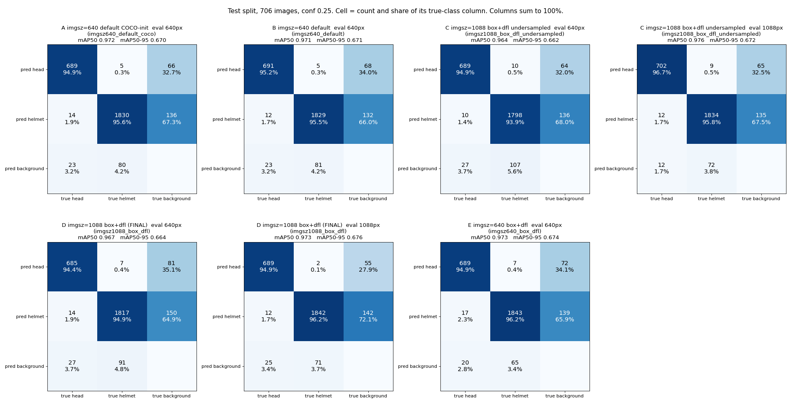
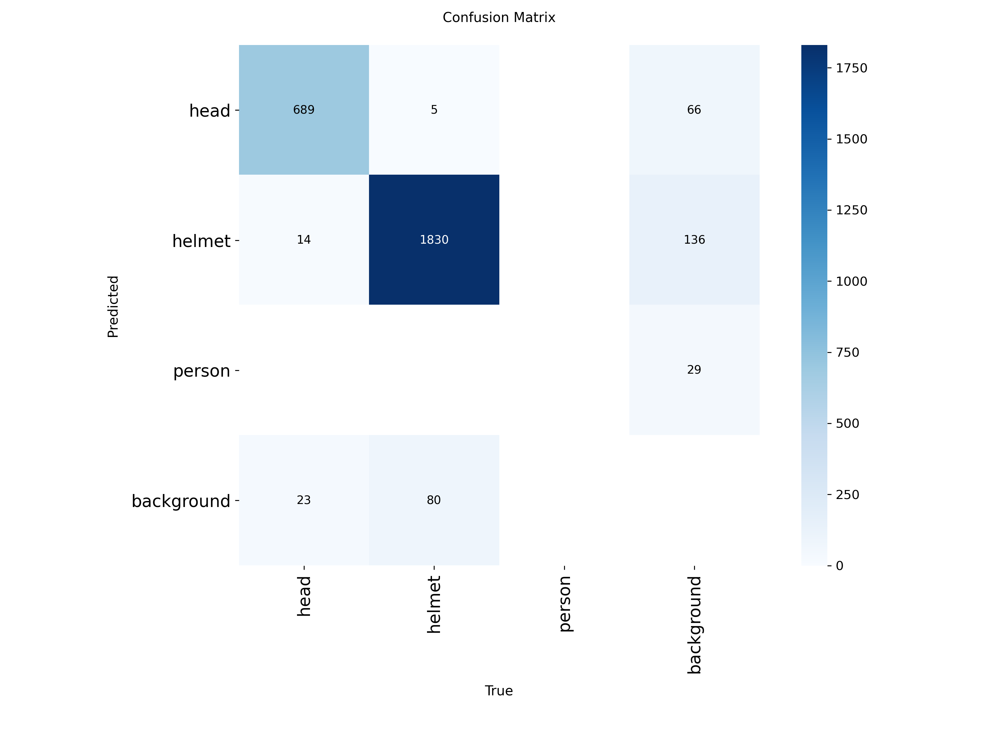
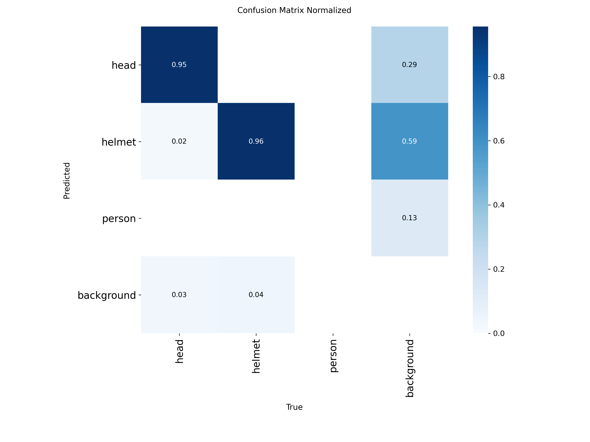
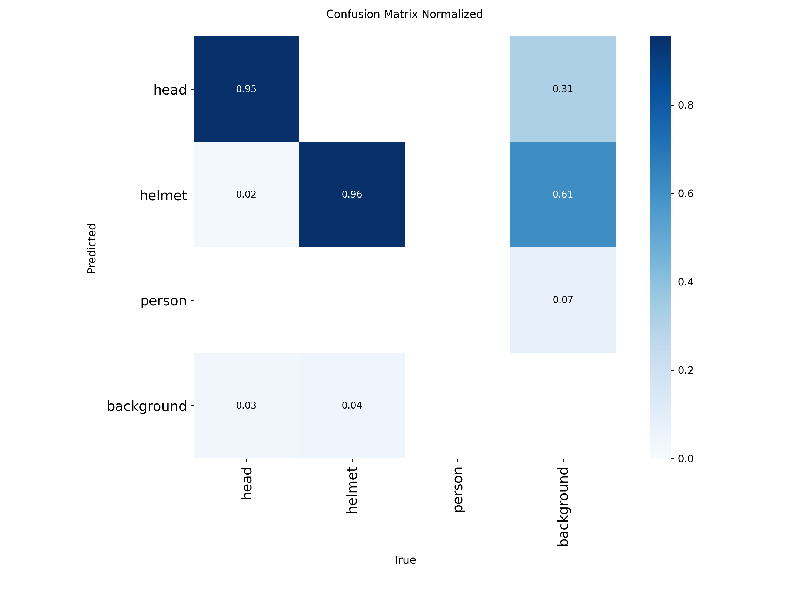
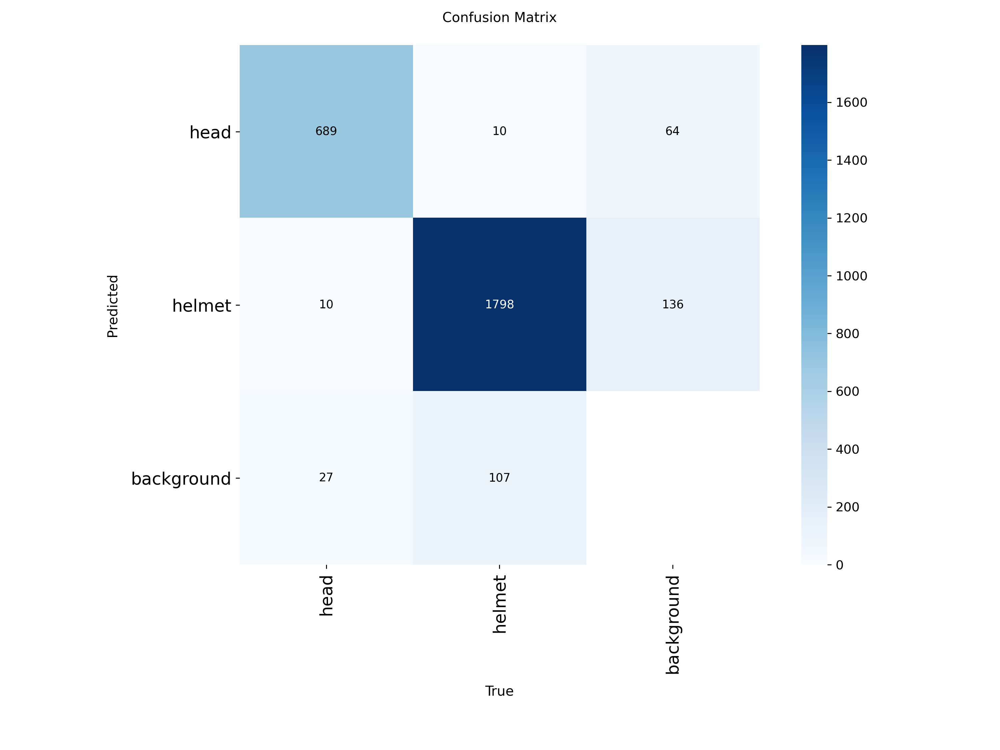
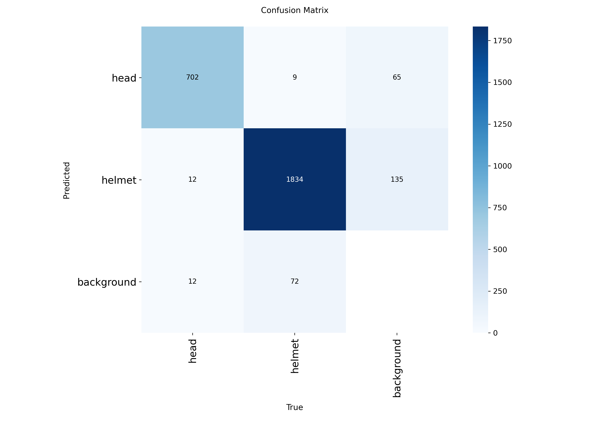
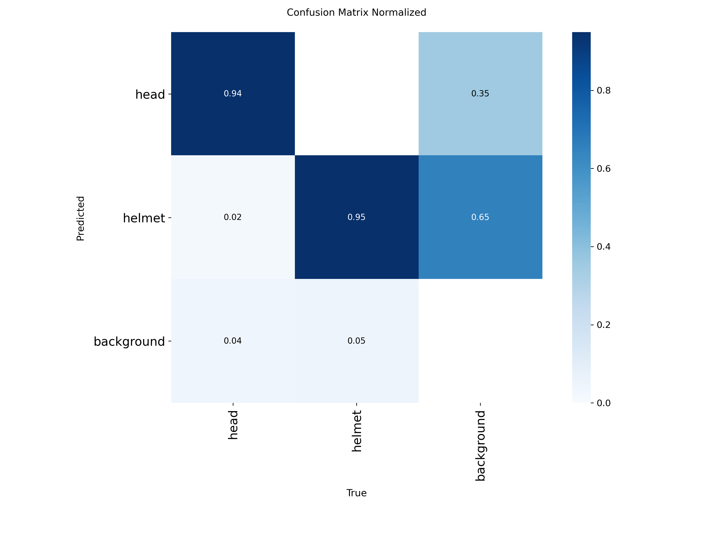
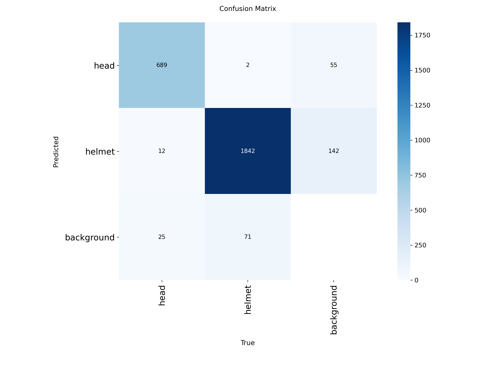
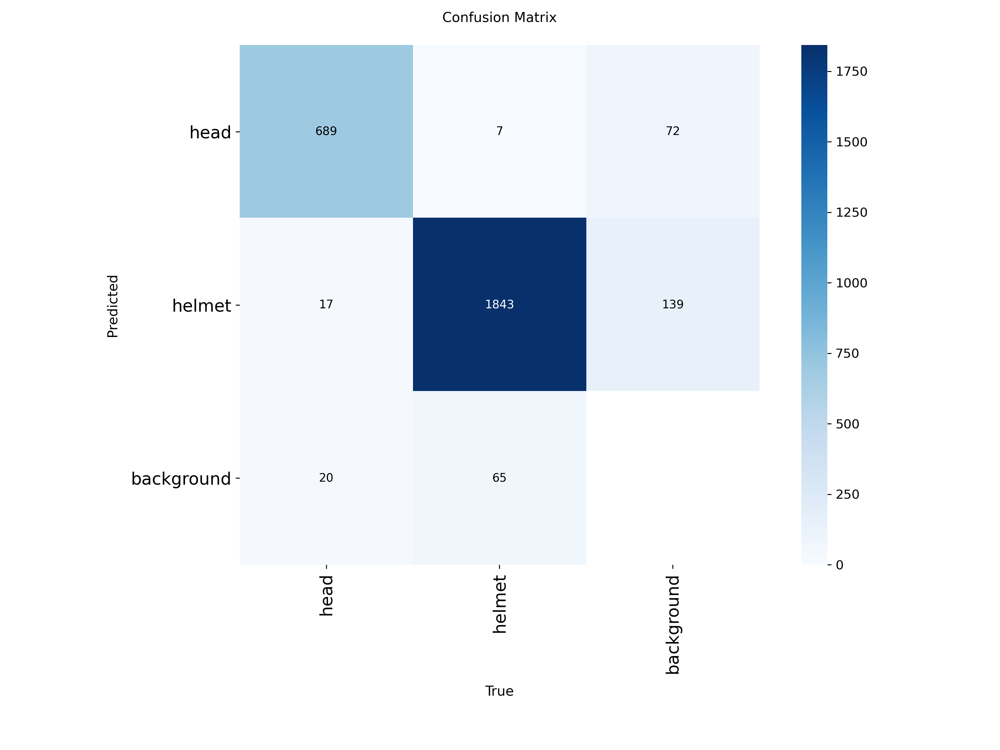

# Confusion matrix of every training run

Test split, 706 images, IoU 0.7, head and helmet only. Counts at conf 0.25 (operating threshold). mAP at conf 0.001 (the mAP protocol), from model_selection.json. Runs A and B are 3-class and their person predictions are dropped. Cell = detections, columns are the true class.

## All runs side by side

## Counts and mAP

| model | imgsz | mAP50 | mAP50-95 | head ok /726 | head as helmet | head missed | helmet ok /1915 | helmet as head | helmet missed | bg FP head | bg FP helmet |
|---|---:|---:|---:|---:|---:|---:|---:|---:|---:|---:|---:|
| A imgsz=640 default COCO-init (imgsz640_default_coco) | 640 | 0.972 | 0.670 | 689 | 14 | 23 | 1830 | 5 | 80 | 66 | 136 |
| B imgsz=640 default (imgsz640_default) | 640 | 0.971 | 0.671 | 691 | 12 | 23 | 1829 | 5 | 81 | 68 | 132 |
| C imgsz=1088 box+dfl undersampled (imgsz1088_box_dfl_undersampled) | 640 | 0.964 | 0.662 | 689 | 10 | 27 | 1798 | 10 | 107 | 64 | 136 |
| C imgsz=1088 box+dfl undersampled (imgsz1088_box_dfl_undersampled) | 1088 | 0.976 | 0.672 | 702 | 12 | 12 | 1834 | 9 | 72 | 65 | 135 |
| D imgsz=1088 box+dfl (FINAL) (imgsz1088_box_dfl) | 640 | 0.967 | 0.664 | 685 | 14 | 27 | 1817 | 7 | 91 | 81 | 150 |
| D imgsz=1088 box+dfl (FINAL) (imgsz1088_box_dfl) | 1088 | 0.973 | 0.676 | 689 | 12 | 25 | 1842 | 2 | 71 | 55 | 142 |
| E imgsz=640 box+dfl (imgsz640_box_dfl) | 640 | 0.973 | 0.674 | 689 | 17 | 20 | 1843 | 7 | 65 | 72 | 139 |

## One matrix per run (count, then normalized by true class)

### A imgsz=640 default COCO-init evaluated at 640 px  (mAP50 0.972, mAP50-95 0.670)

 

### B imgsz=640 default evaluated at 640 px  (mAP50 0.971, mAP50-95 0.671)

 

### C imgsz=1088 box+dfl undersampled evaluated at 640 px  (mAP50 0.964, mAP50-95 0.662)

 

### C imgsz=1088 box+dfl undersampled evaluated at 1088 px  (mAP50 0.976, mAP50-95 0.672)

 

### D imgsz=1088 box+dfl (FINAL) evaluated at 640 px  (mAP50 0.967, mAP50-95 0.664)

 

### D imgsz=1088 box+dfl (FINAL) evaluated at 1088 px  (mAP50 0.973, mAP50-95 0.676)

 

### E imgsz=640 box+dfl evaluated at 640 px  (mAP50 0.973, mAP50-95 0.674)

 

